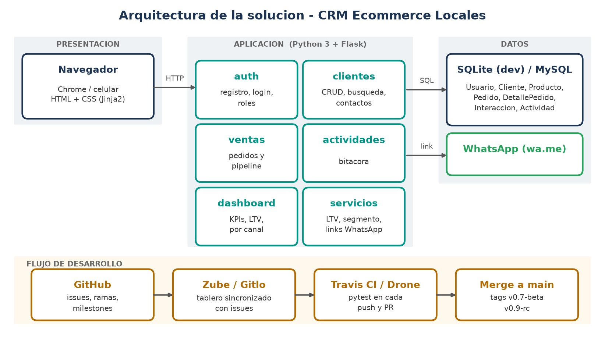

# CRM para Emprendedores de Ecommerce Locales

CRM web para microempresas que venden por Instagram, WhatsApp y tienda en linea.
Junta clientes, pedidos y contactos en un solo lugar, calcula el LTV y segmenta
clientes (nuevo, frecuente, inactivo) para hacer postventa por WhatsApp.

**Equipo 3** - Youssef Garcia (datos y backend) · Emmanuel (frontend y UI)

[](https://app.travis-ci.com/ItsYusei99/crm-ecommerce-locales)

**Sitio y demo:** https://itsyusei99.github.io/crm-ecommerce-locales/

## Estado: Fase III - 70 % funcional

| Modulo | Estado |
|---|---|
| Registro, login y roles (admin, editor, colaborador) | Listo |
| Gestion de clientes (alta, edicion, busqueda, segmento, LTV) | Listo |
| Gestion de contactos (interacciones WhatsApp / IG / llamada) | Listo |
| Seguimiento de ventas (pedidos y pipeline por estado) | Listo |
| Registro de actividades (bitacora) | Listo |
| Dashboard (ventas, ticket, recompra, inactivos, por canal) | Listo |
| Plantillas WhatsApp editables, exportar CSV, catalogo de productos | Pendiente (rc) |
| Despliegue y migracion a MySQL | Pendiente (v1.0) |

## Como correrlo

```bash
python3 -m venv .venv && source .venv/bin/activate
pip install -r requirements.txt
flask --app app init-db      # crea la BD con datos de prueba
flask --app app run          # http://127.0.0.1:5000
```

Usuarios de prueba: `youssef@crm.local` (admin) y `emma@crm.local` (editor), contrasena `demo1234`.

## Pruebas

```bash
python -m pytest -v
```

Travis CI (`.travis.yml`) y Drone (`.drone.yml`) corren las mismas pruebas en cada push y pull request.

## GitHub Pages

`python scripts/build_pages.py` genera en `_site/` la landing (`pages/`) y una demo de solo lectura de la app con datos de prueba. Ese contenido se publica en la rama `gh-pages`.

## Estructura

```
app/
  __init__.py      fabrica de la app y registro de modulos
  db.py            conexion SQLite, init-db y datos de prueba
  schema.sql       tablas (equivalentes al modelo MySQL de la Fase II)
  servicios.py     LTV, segmentacion, bitacora y links de WhatsApp
  auth.py          registro, login, roles
  clientes.py      clientes y contactos
  ventas.py        pedidos y pipeline
  actividades.py   bitacora
  dashboard.py     KPIs
  templates/       vistas Jinja2
tests/             pruebas con pytest
docs/              arquitectura, issues y flujo de trabajo
```

## Flujo de trabajo

Ver [docs/FLUJO_GIT.md](docs/FLUJO_GIT.md). Resumen: `main` (estable), `develop` (integracion),
`feature/*` por modulo, PR con pruebas en verde, milestones **beta** (v0.7) y **rc** (v0.9).

## Arquitectura


